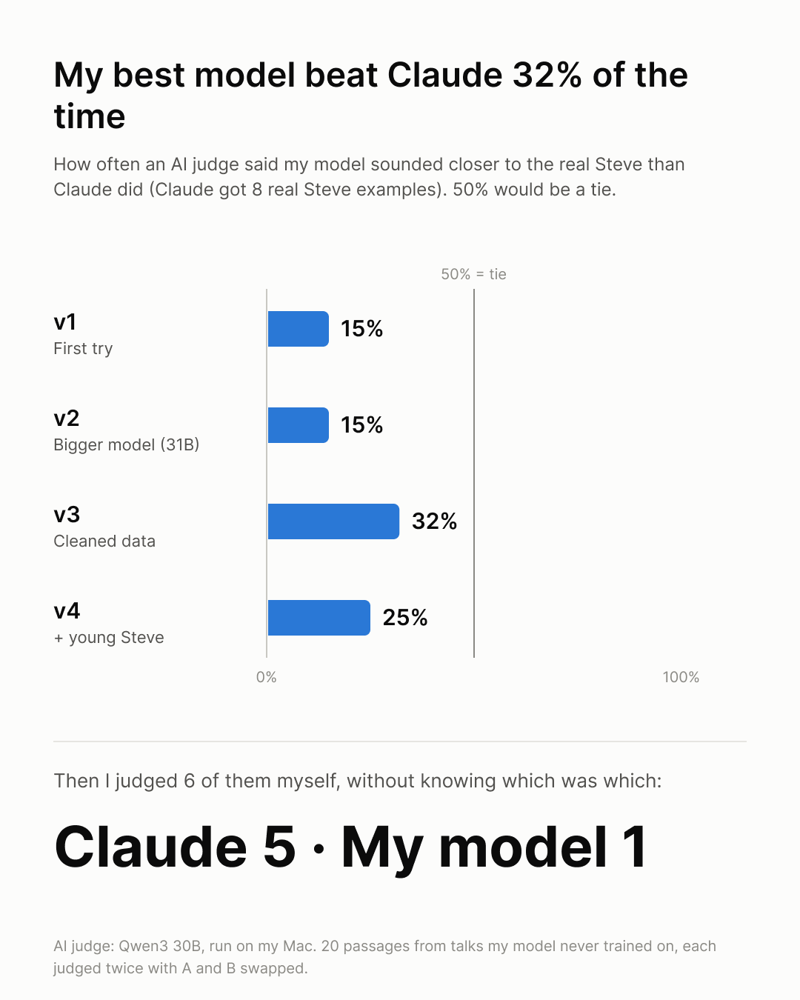

# Say It Like Steve

Turn your writing into the way Steve Jobs explained things.

I wanted to learn how Jobs explained ideas: his word choice, his sentence shapes, the way he builds up to a point. So I collected 29 of his talks and interviews, fine-tuned an open model on everything he said, and then tested it blind against Claude with a few real Steve examples in the prompt.

The prompt won. This repo has the tool and the whole pipeline, so you can use it or rebuild the model yourself.

## Try it

```bash
git clone https://github.com/minhodongcollege/say-it-like-steve
cd say-it-like-steve
./steve "I made a light bulb mascot because it means ideas."
# → Ideas. That's what a light bulb means. So I made it the mascot.
```

Or copy any text, run `./steve`, and paste. The Steve version is already on your clipboard.

| Command | What it uses | Needs |
|---|---|---|
| `./steve` | Claude + 8 real Steve excerpts ([`data/eval/baseline_examples.md`](data/eval/baseline_examples.md)) | [Claude Code](https://claude.com/claude-code), logged in |
| `./steve --local` | Your own fine-tuned model (offline, free) | A Mac with Apple Silicon + a model you trained with the pipeline below |

`./steve` runs through [uv](https://docs.astral.sh/uv/) (macOS). On any other system, `python3 rewrite.py "your text"` does the same thing for the Claude mode.

## Example

**My writing** (first draft, typos and all):
> what if I have this glass that can record me in every converstaion I am in. I have a conversation with this person in te social setting. and when I meet thim next time, I might forget about thier information what was the previous converstion was about. But I will not record this person in vdieo due to the illegal issue, but I can audio record other people as long as I am one of the person in the conversation. when I say a person's name, the glass shows me that person's profile and what they do and what was the project we were talking about. […]

**My fine-tuned model (v3):**
> What if you have this glass? What if you could record every conversation you are in and never forget what was said to you again? You know, because we meet people in social settings sometimes, and we might not remember everything they told us. […] You know, what happens if I say someone's name? Well, when I speak their name, it just brings up on the glass and tells me who they are, what they do, what we talked about last time, and even give me an article summary that they might be interested in based on our previous conversation.

## How it works

Everything runs locally on a Mac (I used an M5 Pro with 48 GB). No paid APIs, except the Claude baseline.

| Step | Script | What it does |
|---|---|---|
| 1. Collect | `get_audio.sh` | Downloads the audio of 29 talks and interviews, 1980–2011 (~26 h), with yt-dlp. Mostly unscripted: interviews and Q&A show how he *explains*, keynotes show him *performing*. |
| 2. Transcribe | `transcribe.sh` | NVIDIA Parakeet v2 (parakeet-mlx). Whisper got stuck in loops on long talks. |
| 3. Keep only Steve | `keep_steve.py` | Builds a voiceprint of Steve (SpeechBrain ECAPA) and drops interviewers, Bill Gates, narrators and the audience. |
| 4. Chunk | `make_chunks.py` | Cuts his speech into 100–250-word pieces at natural pauses. Leaves out keynote demo narration. |
| 5. Clean | `clean_steve.py` | A local Qwen3 30B removes false starts and stutters, and the script checks it only *deleted* words. |
| 6. Make pairs | `make_pairs.py` | Back-translation: Qwen rewrites each Steve piece as a flat paragraph, and again in *my* writing style, keeping the facts and the order of ideas. The model learns "my writing → Steve". |
| 7. Split | `split_data.py` | Splits by whole talk (he reused lines across keynotes, so chunk-level splits would leak). |
| 8. Train | `train.sh` | LoRA on Gemma 4 12B with mlx-lm. About 40 minutes. |
| 9. Test | `run_eval.py`, `check_eval.py`, `judge.py` | Runs held-out talks and my own writing, checks for copying and Apple shortcuts, then blind A/B judging (each pair judged twice with A and B swapped). |

`run_v3.sh` and `run_v4.sh` run steps 5–9 in one go.

## Results

I trained four versions and judged each one against Claude given 8 real Steve excerpts (the baseline).

| Version | What changed | Beat Claude (AI judge, vs. real Steve) |
|---|---|---|
| v1 | First try | 15% |
| v2 | 2.6× bigger base model (Gemma 4 31B) | 15% |
| v3 | Cleaned Steve's side + kept the order of ideas | **32%** |
| v4 | v3 + 9 more talks of young Steve (1980–1991) | 25% |

<p>
  
  
</p>

Then I judged 6 random pairs myself, without knowing which was which: **Claude 5, my model 1.**

## What I learned

- **Fix the data, not the model size.** The 2.6× bigger model didn't help. Cleaning the training text did.
- **The model copies whatever is on the target side.** Spoken transcripts are full of false starts, and v1 learned to write that garble.
- **More data only helps if it sounds like the output you want.** Young Steve rambles in long answers, so adding him made the model wordier.
- **Always test against a simple baseline, blind.** Without the Claude baseline I would have thought my model was great.

## Rebuilding the model

The training data isn't in this repo (see below), but the scripts rebuild it from the public videos listed in `get_audio.sh`. You need macOS on Apple Silicon, [uv](https://docs.astral.sh/uv/), ffmpeg and yt-dlp. Each script's first lines say how to run it.

Two files you make yourself:
- `data/minho_writing.json`: samples of **your** writing for the "my style" pairs (step 6). A list of `{"source": "chat message" | "LinkedIn draft" | "college essay", "text": "..."}`.
- `data/eval/inputs.jsonl`: test texts (step 9). One `{"eid", "source", "input", "steve"}` per line. `steve` is the real quote, or empty for your own writing.

## What's not included, and why

- **Audio, transcripts and training pairs.** Steve's words belong to Apple, Stanford and the other rights holders. The scripts rebuild them from public videos for your own learning.
- **The trained model files.** They were trained on that material.
- **My personal writing samples and test texts.**

`data/eval/baseline_examples.md` contains 8 short excerpts from his public talks, used as examples for the Claude mode, for education.

This is a learning project. It is not affiliated with or endorsed by Apple Inc. or the Steve Jobs estate.

## License

Code: MIT (see `LICENSE`). Gemma 4 is released by Google under its own license.

Made by Minho Dong.
