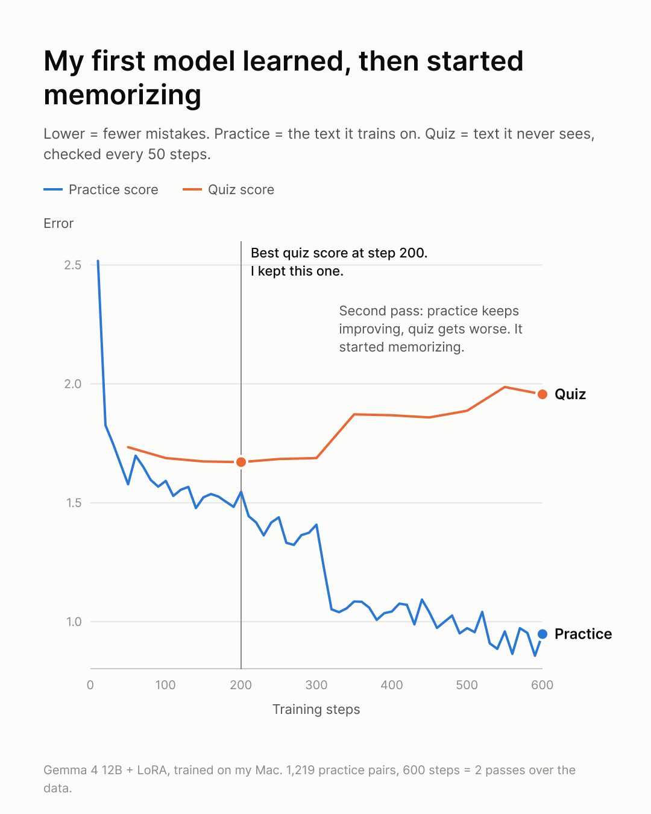

# Say It Like Steve

Turn your writing into the way Steve Jobs would say it, built on 26 hours of his real words.

English is my second language, and speaking in front of people was one of the hardest things for me. I practiced by copying Steve Jobs videos: his tone, how he builds a sentence, where he stops. It helped a lot. But when I sat down to write my own script, there was no video of Steve saying what I wanted to say. So I built this.

## Try it in 30 seconds (any AI)

Open **[PROMPT.md](PROMPT.md)**, copy the box, paste it into ChatGPT, Gemini, Claude or any AI chat, and add your text at the bottom. That's it.

The prompt carries 8 real passages of Steve from this project's dataset, so the AI copies how he really talked, not a movie version of him.

## Why real words, not "write like Steve Jobs"

A plain "write like Steve Jobs" prompt gives you a costume: polished keynote lines like "Here's the magic." The real Steve, especially unscripted, talks differently: "We've all been there." "Look," "You know what?"

I tested it blind. The same AI rewrote 27 texts twice, once with only "write like Steve Jobs" and once with the real passages. A judge that didn't know which was which picked the real-passages version as closer to Steve **86% of the time on my own writing** and **95% of the time against what Steve actually said**. (Tested with Claude as the AI; each pair judged twice with A and B swapped.)

## Command-line tool (macOS)

```bash
git clone https://github.com/minhodongcollege/say-it-like-steve
cd say-it-like-steve
./steve "I made a light bulb mascot because it means ideas."
# → Ideas. That's what a light bulb means. So I made it the mascot.
```

Or copy any text, run `./steve`, and paste: the result is already on your clipboard. Same prompt as PROMPT.md, sent through [Claude Code](https://claude.com/claude-code). `./steve --local` runs a model you trained yourself (below), free and offline.

## How the dataset is built

Everything runs on a Mac (I used an M5 Pro, 48 GB).

| Step | Script | What it does |
|---|---|---|
| 1. Collect | `get_audio.sh` | Audio of 29 talks and interviews, 1980–2011 (~26 h), with yt-dlp. Mostly unscripted: interviews and Q&A show how he *explains*, keynotes show him *performing*. |
| 2. Transcribe | `transcribe.sh` | NVIDIA Parakeet v2 (parakeet-mlx). |
| 3. Keep only Steve | `keep_steve.py` | A voiceprint of Steve (SpeechBrain ECAPA) drops interviewers, Bill Gates, narrators and the audience. |
| 4. Chunk | `make_chunks.py` | 100–250-word passages at natural pauses, one idea each. Keynote demo narration left out. |
| 5. Clean | `clean_steve.py` | A local Qwen3 30B removes false starts and stutters; a check makes sure it only *deleted* words. |
| 6. Pair | `make_pairs.py` | Each passage gets a plain version and a version in *my* writing style, same facts, same order. Ready for training: "my writing → Steve". |

## Train your own model (optional)

The pairs work with any open model. I fine-tuned Gemma 4 12B with LoRA (`train.sh`, mlx-lm, about 40 minutes) in four versions, and tested each blind (`run_eval.py`, `check_eval.py`, `judge.py`; `run_v3.sh` and `run_v4.sh` run the whole loop).

What I learned training it:
- **Clean data beat a bigger model.** A 2.6× bigger base model didn't help; cleaning stutters out of Steve's side did.
- **The model copies whatever is on the target side,** garbled speech included.
- **More data only helps if it sounds like the output you want.** Adding young, rambling Steve (1980–1991) made it wordier.
- **The examples matter more than the training.** My own model didn't beat a strong AI given the same real passages, which is why the tool above uses the passages directly.

<p>
  
</p>

To rebuild, you need macOS on Apple Silicon, [uv](https://docs.astral.sh/uv/), ffmpeg and yt-dlp. Each script's first lines say how to run it. Two files you make yourself: `data/minho_writing.json` (samples of **your** writing: a list of `{"source": "chat message" | "LinkedIn draft" | "college essay", "text": "..."}`) and `data/eval/inputs.jsonl` (test texts: `{"eid", "source", "input", "steve"}` per line).

## What's not included, and why

- **The full transcripts and training pairs.** Steve's words belong to Apple, Stanford and the other rights holders, so the repo shares the scripts that rebuild the dataset from the public videos, for your own learning.
- **Trained model files,** for the same reason.
- **My personal writing samples and test texts.**

The 8 passages in `PROMPT.md` and `data/eval/baseline_examples.md` are short excerpts from his public talks, shared for learning.

This is a learning project. It is not affiliated with or endorsed by Apple Inc. or the Steve Jobs estate.

## License

Code: MIT (see `LICENSE`). Gemma 4 is released by Google under its own license.

Made by Minho Dong.
